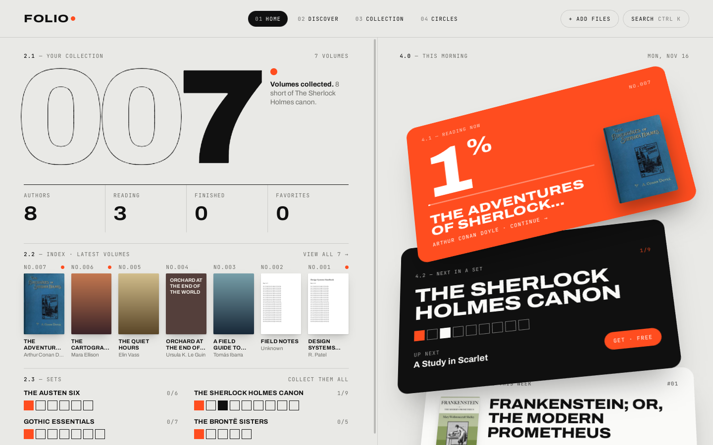

# Digital Library

A desktop home for your ebooks and PDFs. Built with **Tauri 2** (Rust core +
React/TypeScript UI), targeting **Windows** first.



> Status: working app with Discover, Collection and the Index design. Circles (community) needs a backend and is previewed.

## What works today

- **Home:** your collection as identity, with a giant volume count, stats, an index of numbered volumes,
  **sets** to complete (the Austen Six, the Holmes canon…) and a "Tonight" card deck
- **Collected editions:** designed showcases for great books. First up, the **Holy Bible** in an Orthodox theme:
  the book centred on a dark stage among real icons, with scroll parallax and a choice of KJV or Douay-Rheims
- **Light, dark and system themes**, and on Windows 11 a frameless window on Mica with Index-styled controls
- **Fast with big libraries:** cover thumbnails, windowed grids and range-loaded PDFs (see the benchmarks in
  [Architecture](docs/ARCHITECTURE.md#performance-and-memory))
- **Reader:** calm and easy on the eyes, with Paper, Sepia, Dusk and Night themes, the Literata and
  Atkinson Hyperlegible typefaces, size, spacing, line-length and pages/scroll controls, chapter names and time left

- **Discover:** browse and search 70,000+ free public-domain books from Project Gutenberg,
  with curated rows, popularity ranking, summaries and one-click "Get" into your library

- Read whatever you bring: EPUB, PDF, Kindle (MOBI, AZW, AZW3, PRC), FictionBook (FB2, FBZ),
  comics (CBZ) and plain text (TXT, converted to a proper paginated book on import).
  DRM-protected files (Kindle, Adobe, Readium LCP) are detected and reported rather than half-opened
- Import via a picker, by dragging files or folders onto the window,
  or by passing them as command-line arguments (how Windows "Open with" works)
- Metadata extraction (title, authors, description, language, ISBN, page count)
- Cover extraction from EPUB, Kindle, FB2 and comic files; first-page covers for PDFs; generated placeholders otherwise
- Duplicate detection by content hash
- Instant full-text search across title, author and description (accent-insensitive)
- Shelves: All, Continue reading, Favorites, Finished; filter by format; four sort orders
- Built-in readers: paginated or scrolling EPUB, continuous-scroll PDF, and foliate-js for
  Kindle, FB2 and comics, all themed by the same reader settings
- Reading position saved automatically and restored when you reopen a book

## Download (Windows)

Get the latest build from [Releases](https://github.com/ChickenExe/digital-library/releases): the `x64-setup.exe` installer is recommended, and there's also an `.msi` and a portable `.exe`. Builds aren't code-signed yet, so if Windows SmartScreen warns, choose **More info → Run anyway**.

Releases are built on a Windows runner by `.github/workflows/release.yml`.

## Getting started

Prerequisites: Node 20+, Rust (stable), and on Windows the
[Microsoft C++ Build Tools](https://visualstudio.microsoft.com/visual-cpp-build-tools/)
(WebView2 ships with Windows 10/11). See the
[Tauri prerequisites](https://v2.tauri.app/start/prerequisites/) for other platforms.

```bash
npm install
npm run dev        # launches the app with hot reload
npm test           # Rust unit + integration tests
npm run build      # release build → src-tauri/target/release/bundle/ (.msi + setup .exe)
```

Need demo content for UI work?

```bash
python3 scripts/make-sample-books.py ./sample-books
```

Then drag the `sample-books` folder onto the app window.

## Docs

- [Architecture](docs/ARCHITECTURE.md): how the pieces fit and why they were chosen
- [Storefront strategy](docs/STOREFRONT.md): how we attract publishers and booksellers to sell here
